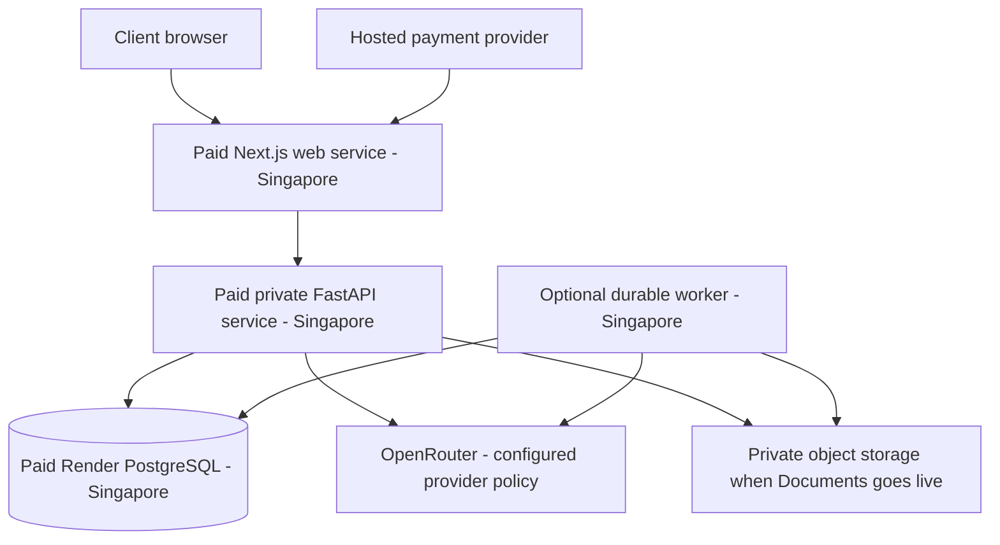

# BenchQ deployment review and proposed launch plan

Status: proposal for review; no infrastructure provisioned, production settings changed, or billing contracts approved by this document. This supplements the team plan, rather than changing the accepted product contracts.

**Current demo choice, 2026-11-01:** the user now wants free Render compute. Follow [the complete free deployment guide](./render-free-deployment.md) for that setup. The paid sizing and private API topology below are retained for a later paid pilot; free backend compute must instead use a public HTTPS URL and the free database expires after 30 days.

## 1. Recommendation and scope

**Decision updated 2026-10-31: use Render in Singapore for the initial pilot.** The user chose Render because of budget and explicitly accepted Singapore hosting, replacing the earlier India-only hosting requirement. Start with one firm and 10–15 BDEs; the proposed billing allowance remains 100 candidate additions per BDE per month.

Use a Hobby workspace with paid Next.js, FastAPI and PostgreSQL services. Base compute is approximately **$51/month**, or **$76/month with an additional 2 GB worker**, before storage, bandwidth, AI and taxes. These are test starting points, not capacity guarantees. Pro and automated scaling can wait until the application runtime and measured demand justify them. Render workspace members are hosting administrators, not the firm's BDE users. [Pricing](https://render.com/pricing), [workspace features](https://render.com/docs/platform-features-by-plan).

Keep web/API/database in the same Singapore workspace/region, with the API and database reached privately. OpenRouter is the intended AI provider; document the actual downstream processing/retention settings rather than describing this as Singapore-only AI. AWS Mumbai is an alternative only if an India-only requirement returns, not the current deployment target. [Render regions](https://render.com/docs/regions), [private networking](https://render.com/docs/private-network).

This review inspected the route tree and API adapters, backend auth/scoping and isolation inventory, candidate/billing-related models, background runtime, containers, environment examples, CI and team integration plans. It is an architecture and deployment readiness review, not an executed penetration test, a live end-to-end certification or a capacity measurement.

## 2. What the repository actually contains

| Area | Observed implementation | Launch implication |
|---|---|---|
| Frontend | Next.js 16.3.5 / React 19, Node 22+ requirement; server-side session gates and `/api` proxy | Run a Node server/container; static-only hosting does not fit this app |
| Backend | Python 3.12, FastAPI, SQLAlchemy, PostgreSQL 16, Alembic | Deploy the existing Python backend, with managed PostgreSQL and controlled migrations |
| Tenancy/auth | Firm-scoped queries; OWNER/MANAGER/BDE/VIEWER; hashed opaque sessions, Argon2id passwords, Secure/HttpOnly cookies; read-only audited platform support views | Retain this model; infrastructure does not replace application authorization |
| Real frontend integrations | Sessions, team/invites, ledger and parts of Super Admin; candidates available behind a build-time flag | Confirm feature-by-feature real persistence before enabling for customers |
| Mock frontend integrations | Jobs, applications, resumes, documents, inbox, claims/records and AI adapters still import mocks; platform candidate usage also mocked | A successful deployment would still be a partially simulated product |
| Admin writes | `platformApi` marks plan/limit edits, suspend/reactivate, user activation and several other writes unavailable | The Super Admin cannot yet operate the intended commercial product |
| Background work | APScheduler starts in FastAPI lifespan; task registry, concurrency gates and sign-in throttle use process memory | Exactly one API process today; move these responsibilities before API replication |
| Browser/document processing | Playwright Chromium, PDF/Word parsing and AI work | Size and isolate workers separately from ordinary API traffic |
| Files | Parsed original resumes stored as binary in PostgreSQL; Documents adapter mocked; local backup/auth volumes in Compose | Propose S3 for durable document objects; retain DB metadata and migrate existing bytes deliberately |
| Billing | Plans have seat/candidate limits, but no subscription, invoice, payment webhook or monthly usage implementation | A billing backend and agreed product contract are required |
| Delivery | PR CI runs checks; backend Dockerfile exists; no frontend Dockerfile or production infrastructure/deploy workflow | Add production packaging and CI/CD; existing Compose is a local development setup |

Evidence: [package.json](../package.json), [API adapters](../src/lib/api/), [platform adapter](../src/lib/api/platform.ts), [session implementation](../backend/auth/sessions.py), [candidate storage](../backend/models/candidates.py), [runtime](../backend/main.py), [job monitor](../backend/job_monitor.py), [CI](../.github/workflows/ci.yml).

## 3. Launch blockers

1. **Close the documented isolation exceptions.** `backend/tests/isolation_cases.py` explicitly exempts global Persona/autofill endpoints, and records shared job status/score mutation exceptions. The current passing-matrix design permits these known gaps. Close them or remove/deny the affected endpoints in production; hiding their UI is insufficient. Extend tests to worker execution and object download authorization, plus manager/BDE scope within a firm. Existing isolation tests are a useful foundation, not proof that all routes are ready.
2. **Finish the real customer journey.** Candidate onboarding → job selection → resume verification/tailoring → submission tracking must use real persistence for whichever features are sold. Finish the corresponding team tracks or explicitly remove unfinished features from the launch scope.
3. **Enforce Truth Guard in backend export.** The claims table has a VERIFIED-requires-evidence constraint. The existing legacy PDF export path renders resume JSON without checking the claims gate. Connect the Record and enforce export eligibility server-side before releasing resume exports; test direct API calls as well as UI behavior.
4. **Implement billing and real admin controls.** Monthly quotas, effective plan changes, payment state and operational suspension must work through the backend. Existing active-candidate limits are not monthly quotas.
5. **Make essential background work durable.** Keep one API process/replica for the limited pilot, with bounded concurrency and a clear retry path for restart interruptions. Before relying on long-running customer workflows, move their execution to a Render worker with durable job identity, tenant context, retries, leases and idempotency. A PostgreSQL-backed queue can avoid an extra datastore initially. Extract scheduling before API replication, without running both the old scheduler and new cron tasks for the same work. A job table alone does not make the current in-memory execution durable.
6. **Complete the production layer.** Shared rate limits, request/upload/time limits, trusted proxy handling, security headers, structured redacted logs and database readiness checks. The current `/health` deliberately does not test the database. Set production origins and secure cookies explicitly. Forwarded client-IP headers must be trusted only from the controlled proxy chain.
7. **Produce a clean supported build.** Fix the local architecture/toolchain mismatch and validate Linux production builds with Node 22+ and locked dependencies. Do not ship a container derived from the developer's mounted filesystem.

Evidence: [isolation exceptions](../backend/tests/isolation_cases.py), [export implementation](../backend/api/routes_resumes.py), [claim constraints](../backend/models/candidates.py), [production task owner](./team/uzair.md), [deployment/billing owner](./team/abdul.md).

## 4. Data location and OpenRouter

**Singapore hosting is accepted.** The earlier requirement to keep all candidate data in India is superseded for the selected Render hosting. Keep the frontend, backend and database in Singapore. Object-storage and backup locations should be recorded as part of the same deployment inventory.

**OpenRouter remains the intended AI provider.** Render's Singapore location does not constrain where OpenRouter or its downstream providers process requests. Configure routing/retention and provider fallbacks deliberately; disable optional prompt/completion logging, prefer supported zero-retention endpoints and deny provider data collection where appropriate. Do not silently fall back to a provider that violates the selected policy. ZDR governs retention, not processing geography, and has policy exceptions; it is not an unconditional confidentiality guarantee. [OpenRouter ZDR](https://openrouter.ai/docs/guides/features/zdr), [provider routing](https://openrouter.ai/docs/guides/routing/provider-selection).

The user's acceptance of Singapore hosting does not establish a Singapore-only AI guarantee or waive ordinary handling controls. Document the actual third-party processing with the client before enabling candidate AI; minimize resume content sent, keep API keys backend-only, and avoid personal data in operational logs. Removing names and emails does not reliably anonymize employment history.

The planned Gmail inbox integration also uses a separate provider. Requesting restricted Gmail scopes may require OAuth verification and a security assessment, subject to Google's exceptions. Start that process early if inbox access is in the launch scope. [Google Gmail scopes](https://developers.google.com/workspace/gmail/api/auth/scopes), [restricted-scope verification](https://developers.google.com/identity/protocols/oauth2/production-readiness/restricted-scope-verification).

## 5. Initial architecture

| Component | Pilot starting point | Growth / limits |
|---|---|---|
| Workspace | Hobby, $0 workspace fee; one hosting administrator | App BDEs do not consume Render seats. Upgrade to Pro for shared administration, environment isolation or autoscaling |
| Next.js | Paid 512 MB service, $7/month | Test memory and SSR; 2 GB adds $18/month if needed. Build resources differ from runtime resources |
| FastAPI | Paid 2 GB service, $25/month; exactly one replica/process initially | Keep the current scheduler singleton. Bound browser/AI concurrency; extract background work before horizontal scaling |
| Database | Paid 1 GB PostgreSQL, $19/month plus storage | Use internal URL and disable unnecessary external access. Keep version 16 initially to match local/CI |
| Documents | Existing parsed originals remain in PostgreSQL initially | Measure DB growth; implement private object storage for the real Documents track. Do not put customer files on ephemeral app disk |
| Worker | Optional paid 2 GB worker, +$25/month | Requires a real durable handoff; adding another service alone does not extract the current background code |
| Durable jobs | Proposed PostgreSQL-backed queue for the small pilot | Persist job identity, tenant context and idempotency; no Redis cost required initially. Add a paid queue/cache only for a demonstrated need |
| Scheduling | Existing scheduler initially; short cron tasks after extraction | Avoid running the scheduler in both API and worker. Cron has separate usage/minimum charges |
| Operations | Render metrics/logs plus application error/uptime checks | Redact PII/secrets; alert on failures, memory, storage and spend |

The $51 base is a controlled single-instance pilot, not an always-available design. In-process jobs can be interrupted by restart/deploy; move any essential long-running work to durable worker execution before relying on its completion. Until then, constrain released features and provide a clear retry/recovery path. A separate worker is a reliability step when heavy workflows go live, not automatic horizontal scaling.

Render's private network works within the same workspace and region. Preserve the existing browser → Next.js `/api` rewrite → private FastAPI cookie/session design. The payment webhook reaches the public Next.js origin and forwards to the signature-verified backend route. [Private networking](https://render.com/docs/private-network).

Paid PostgreSQL on Hobby currently provides a three-day point-in-time recovery window; Pro extends it to seven days. Test restoration and connection switching, and retain encrypted logical exports outside the database for the agreed retention period. Pro does not make the database highly available automatically. [Backups](https://render.com/docs/postgresql-backups).

Keep staging synthetic and in a separate workspace/datastore when using Hobby: separate service names alone do not create a network isolation boundary. Pro adds environment-level network isolation. Do not attach a persistent disk simply to retain uploads: it prevents horizontal scaling and zero-downtime deploys; use object storage when file storage becomes live. [Workspace features](https://render.com/docs/platform-features-by-plan), [disks](https://render.com/docs/disks).

All sizes require load testing with 15 concurrent BDEs plus owner/manager. Increase capacity from response latency, CPU/RAM, database performance and durable queue age. Remove the embedded scheduler/in-memory coordination before adding API replicas, and cap concurrency and spending. Do not create a separate Render stack per firm.

## 6. Billing proposal for the stated model

This section proposes semantics for sign-off before changing `docs/02` or the schema. It does not silently replace Q44–Q46.

| Rule | Proposal |
|---|---|
| Tenant being charged | The firm/OWNER; BDEs are included seats, not independent payment accounts |
| Sold capacity | A configured seat count, initially 10 or 15 BDEs; OWNER/MANAGER/VIEWER remain free per Q44 |
| Monthly inclusion | 100 successful candidate onboardings per BDE per subscription period: 1,000 at 10 seats or 1,500 at 15 seats, with per-BDE caps and a firm-wide ceiling |
| Period | Explicit subscription start/end timestamps; display in the firm's timezone. Proposed reset on subscription anniversary, not an unreliable midnight cron |
| Billable action | Define first successful onboarding attributed to a billable BDE allocation. Failed validation/retries do not consume another unit. Bound unassigned drafts separately so they cannot bypass paid capacity |
| Existing working-candidate limit | Keep as a separate entitlement if desired; do not reuse `candidate_limit` for a monthly meter |
| Reassignment/deletion | Do not automatically refund usage or create new capacity. Define attribution and seat-replacement rules so rotating BDE accounts cannot bypass the firm ceiling |
| Capacity exhausted | Block further billable onboarding with usage and upgrade information; preserve existing candidates and history |
| AI cost | Separate allowance/budget for parsing, tailoring and scoring. A candidate credit must not imply unlimited AI calls |
| Subscription state | Proposed pending/active/past-due/cancelled lifecycle with an explicit grace policy and paid-through date; financial state is separate from a Super Admin's manual suspension |

**Permission decision:** the user describes BDEs adding candidates, but the current permission table permits only OWNER/MANAGER creation. Either let those roles create against a BDE's allowance or approve a BDE-create permission change before implementation.

Enforce quota in the same database transaction as candidate creation and an append-only usage event. Lock the relevant period/allocation, compute usage from durable events, reject over-limit changes, and use unique idempotency keys. Two simultaneous final-credit requests must result in exactly one successful consumption. Frontend counters and payment-provider meters cannot enforce this.

The Super Admin needs real plan/seat/period controls, usage drill-down by BDE, invoices and payment status, auditable credits/overrides, and explicit upgrade/downgrade timing. The OWNER needs current plan, remaining usage, payment/invoice access and an upgrade route. Changing a plan catalogue must not retroactively rewrite existing terms.

For an Indian merchant selling to Indian firms, evaluate **Razorpay Subscriptions**, subject to account approval, recurring-method support and customer currency requirements. Stripe India currently requires an invitation for new accounts. Use hosted checkout; do not store card data. Keep only provider references, invoice/payment state and entitlement facts. [Razorpay subscriptions](https://razorpay.com/docs/payments/subscriptions/), [Stripe India availability](https://support.stripe.com/questions/stripe-accounts-are-invite-only-in-india).

Payment completion is established by verified server-side events/reconciliation, not the browser redirect. Validate signatures using the raw webhook body, persist/deduplicate provider event IDs, handle out-of-order delivery and retry processing. Add an explicit webhook route classification and narrow signature-verified ingress path without weakening cookie/Origin checks on ordinary API routes. Use a transactional outbox or equivalent reliable handoff where DB state must also enqueue work. [Razorpay webhook validation](https://razorpay.com/docs/webhooks/validate-test/).

A manual Super Admin invoice/entitlement pilot is possible if the customer agrees, but quota enforcement still needs to be real. Tax/GST invoice requirements and grace/upgrade rules must be agreed before the billing implementation.

## 7. Delivery sequence and ownership

| Phase | Owner / coordination | Deliverable and acceptance |
|---|---|---|
| A: freeze launch decisions | Abdul with client | 10 vs 15 seats, creation permission, quota event/period, retention, paid features and downtime expectations recorded; Singapore hosting decision recorded; OpenRouter routing/privacy policy selected |
| B: complete real product path | Existing Samad/Zuhair/Abdul tracks | No mock-backed sold workflow; isolation exceptions closed or affected endpoints denied; backend export gate enforced |
| C: runtime and billing | Uzair production layer; Abdul billing | Single-replica pilot controls; durable worker handoff for essential heavy jobs; safe uploads/logging; real entitlements, usage races and payment retry cases tested |
| D: deploy staging | Abdul with Uzair | Render Blueprint/service configuration, separate staging workspace/DB/secrets, synthetic data only; frontend/API builds and Singapore region verified |
| E: prove recovery and load | Uzair with module owners | Test 15 concurrent BDE sessions plus owner/manager, resume-upload bursts, browser-worker memory, invoice replay, cross-firm attacks, AI/database outages and DB restore |
| F: first customer | Abdul | Production bootstrap admin, owner invite, real plan and quota; first few users, then full team after representative night-shift validation; dashboards/alerts and support runbook live |

These phases describe dependency order, not a promise that unfinished modules can be completed in a few days. Infrastructure setup is only part of the remaining work.

Deployment pipeline: existing PR checks → locked Node 22+/Python builds → staging smoke checks → controlled production migration → Render rollout → smoke checks. Connect the GitHub repository with minimal permissions and deploy only after required checks pass. Keep secrets in Render configuration and out of build logs. The current startup migration uses an advisory lock; preserve it for the single-instance pilot, use additive migrations, and test compatibility during overlapping old/new deployments. Before replicas, move migrations to a serialized release step. Do not blindly reverse a schema containing customer data.

Set `BENCHQ_ENV=production`, correct `ALLOWED_ORIGINS`, secure cookies and private `BACKEND_URL`. The rewrite configuration needs the correct backend destination at frontend build time; `NEXT_PUBLIC_*` flags are also built into the client bundle. Do not ship dev routes/demo accounts. Add frontend packaging deliberately: the current `.dockerignore` excludes everything except `backend/` and cannot be reused unchanged for a frontend image. Build the backend without developer auth-volume dependencies; the production OpenRouter route should not require personal subscription CLI logins.

Proposed acceptance targets for staging: ordinary API p95 under 500 ms at the agreed pilot load, no quota overrun under concurrent requests, no cross-firm/role leaks, durable jobs surviving a worker restart, and tested restoration within an agreed recovery window. Treat these as targets until measured. AI completion latency gets its own queue/processing target. Set recovery-point/recovery-time commitments only after a timed restore; a daily logical dump alone can lose nearly a day of work.

Security baseline: account MFA, strongest authentication for Super Admin including application MFA before production admin use, least privilege, no public DB/bucket, encrypted connections/storage/backups, file-type/size checks and malware isolation, request/AI cost limits, redacted structured logs, dependency/container scans, and evidence-backed export enforcement. These map to actual candidate-data and payment flows, rather than a claim that selecting Render makes the application secure.

## 8. Budget and sizing

| Item | Monthly base compute |
|---|---:|
| Hobby workspace | $0 |
| Next.js, 512 MB | $7 |
| FastAPI, 2 GB | $25 |
| PostgreSQL, 1 GB RAM | $19 |
| **Initial base** | **$51** |
| Optional separate 2 GB worker | +$25 |
| **Base with worker** | **$76** |

These are published-price starting points checked on 2026-10-31, not a complete bill or capacity guarantee. Database storage, object storage, bandwidth/build overages, cron, domain/email, taxes and AI are extra. A Next.js upgrade from 512 MB to 2 GB adds $18/month. Pro adds a $25/month workspace fee when needed; it is not required merely because the application has 15 BDE users. Confirm checkout pricing before provisioning. [Render pricing](https://render.com/pricing), [published price examples](https://render.com/articles/render-vs-netlify).

Use paid compute and a paid database for customer data. Free web services sleep and free databases expire after 30 days without recovery features. [Free service limitations](https://render.com/docs/free).

At 15 BDEs, the proposed allowance is 1,500 new candidates/month. At a representative 2 MB original per candidate, originals alone add about 3 GB/month before tailored files, evidence, mail and backups. Do not size database storage at its minimum simply because memory starts at 1 GB. Monitor growth and plan the object-storage move.

OpenRouter is a separate usage budget: `sum(calls by feature × input/output tokens × selected model rates)`, plus retries and fallback behavior. Bound concurrent jobs and output tokens, cap retries and provider/key spend, and report AI cost by firm and BDE. Select the model and measure a representative night shift before quoting an AI-inclusive subscription price.

## 9. Verification performed during this review

| Check | Result |
|---|---|
| `pnpm typecheck` | Passed |
| `pnpm lint` | Passed |
| `pnpm test` | Could not start Vitest: missing `@rollup/rollup-darwin-x64` native dependency |
| `pnpm build` | Failed during CSS compilation: missing `lightningcss.darwin-x64.node` |
| Local runtime | Node 20.9.0; repo requires Node 22+, and Next reported Rosetta translation |
| Backend/live/load/security tests | Not executed in this review; no claim that they pass |

The native dependency failures match the architecture issue documented in [troubleshooting](./troubleshooting.md). Restore a supported, consistent toolchain and repeat CI on Linux before release. No application code or existing product contracts were changed for this review.

See [platform research](./deployment-platform-research.md) for additional first-party references and the evaluated alternatives.
